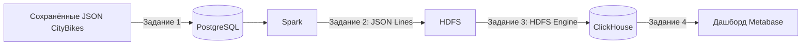

# CityBikes: финальный проект

Цель проекта - пройти путь от исходных данных о велопрокате до дашборда
для сравнения сетей и станций. Данные CityBikes API загружаются в PostgreSQL.
Spark строит витрину в HDFS, ClickHouse хранит её для запросов, Metabase показывает показатели.

Используется сохранённая выгрузка CityBikes API от 10.10.2026:
815 сетей и 4 153 станции из пяти выбранных сетей. Скачивать данные для запуска
не нужно. В итоговую витрину входят только сети со скачанными станциями.

## Как устроен проект



Docker Compose запускает все сервисы в одной сети. Airflow управляет заданиями 1-3
через LocalExecutor. Spark работает внутри задачи Airflow в режиме `local[2]`.
HDFS состоит из NameNode и одного DataNode. В PostgreSQL хранятся исходные данные
и отдельные служебные базы Airflow и Metabase.

В PostgreSQL создаются таблицы `anton_mishin_networks` и `anton_mishin_stations`.
Ключи - `id` сети и `(network_id, id)` станции. Вложенные поля сохраняются в JSONB,
пропущенные значения - в NULL. Повторная загрузка обновляет строки по ключу.

Spark объединяет таблицы по ID сети, разбирает вложенные поля, приводит типы
и даты, убирает пробелы. К полям из задания добавляются `companies_count`
и `network_station`. Результат - 26 полей в формате JSON Lines,
каталог `/anton_mishin/dm` в HDFS.

ClickHouse читает файлы через HDFS Engine и копирует данные в таблицу
`citybikes.anton_mishin_dm` с движком MergeTree. Metabase выполняет запросы
к этой таблице. Настройки дашборда восстанавливаются из `Task4/metabase.dump`
при первом запуске; существующая база Metabase и правки в интерфейсе сохраняются.

Стек: Python 3.11, SQL, Airflow 3.2.1, PostgreSQL 16, Spark 3.5.5, Java 11,
Hadoop 3.2.1, ClickHouse 26.8.22.13, Metabase v0.64.1.x, Docker Compose и Git.

## Подготовка к запуску

Нужны Docker с поддержкой Linux-контейнеров и Docker Compose.
Запуск проверен с 8 ГБ памяти, выделенными Docker.
Python, Java и Spark устанавливаются внутри образа.

1. Скачать репозиторий и открыть терминал в его корне.
2. Запустить Docker и выполнить:

   ```powershell
   docker compose up -d --build
   ```

3. Проверить состояние сервисов:

   ```powershell
   docker compose ps -a
   ```

   Дождаться `healthy` у работающих сервисов. У `airflow-init` и `metabase-db-init`
   должен быть статус `Exited (0)`. Первый запуск занимает время на сборку и скачивание образов.

4. Открыть [Airflow](http://localhost:8080). Логин и пароль: `airflow`.
5. Выбрать один из двух способов ниже.

## Запуск всего проекта

1. Найти DAG `anton_mishin_citybikes_pipeline` и включить переключатель рядом с ним.
2. Нажать Trigger. Он выполнит задания 1-3 по порядку: PostgreSQL, Spark и HDFS, ClickHouse.
3. Дождаться статуса `success` у всего запуска и открыть дашборд по инструкции ниже.

## Запуск по заданиям

Для каждого DAG включить переключатель, нажать Trigger и дождаться `success`
перед переходом к следующему.

1. Задание 1: `anton_mishin_citybikes_to_postgres`. В PostgreSQL появятся 815 сетей и 4 153 станции.
2. Задание 2: `anton_mishin_citybikes_dm`. В HDFS появится витрина из 4 153 строк и 26 полей.
3. Задание 3: `anton_mishin_citybikes_to_clickhouse`. Витрина загрузится в ClickHouse.
4. Задание 4: открыть дашборд по инструкции ниже. Его настройки уже восстановлены при запуске Docker.

Задание 5 - этот README. Отдельного запуска у него нет.
Общий DAG и отдельные этапы используют одни таблицы и каталоги, поэтому одновременно их запускать не нужно.

## Дашборд и результат

1. После успешной загрузки открыть [дашборд Metabase](http://localhost:3000/dashboard/2).
2. Войти с логином `anton.mishin@example.com` и паролем `Citybikes2026!`.
3. Для приложенной выгрузки без фильтров проверить верхние показатели:
   24 245 доступных велосипедов, 50 141 свободное место,
   2 722 станции с велосипедами и 1 431 без велосипедов.

Ниже показаны сравнение сетей, электровелосипеды, способы оплаты, статус аренды,
полнота данных и список станций. Фильтр «Сеть» действует на весь дашборд,
остальные фильтры - только на список станций.

Это один снимок, без истории поездок. У части источников старые метки времени,
поэтому остатки нельзя считать текущими. Свободные места не показывают число
велосипедов в аренде. По этим данным также нельзя определить популярность станций.

В ClickHouse пропуски массивов компаний и оплаты заменены на `[]`;
это не доказывает отсутствие компаний или способов оплаты.
Для `station_last_updated` без часового пояса UTC принят условно, исходные часы сохранены.

Расписания у DAG нет. Повторный запуск использует ту же выгрузку, обновляет записи
PostgreSQL и заменяет витрины HDFS и ClickHouse. Новые данные из API не скачиваются.
Логи и ошибки доступны в Airflow у соответствующей задачи.

Остановить проект с сохранением данных:

```powershell
docker compose down
```

Базы, HDFS и логи сохраняются в Docker volumes. Адреса `localhost`
открываются на компьютере, где запущен проект.

## Файлы заданий

- [Task1](Task1/README.md): загрузка JSON в PostgreSQL, [DAG](Task1/dags/citybikes_to_postgres.py).
- [Task2](Task2/README.md): обработка Spark и HDFS, [DAG](Task2/dags/citybikes_to_hdfs.py).
- [Task3](Task3/README.md): перенос в ClickHouse, [DAG](Task3/dags/citybikes_to_clickhouse.py).
- [Task4](Task4/README.md): сохранённый дашборд Metabase.
- Задание 5: этот README с описанием проекта, схемой и инструкциями.
- [Общий DAG](dags/citybikes_pipeline.py): последовательная загрузка данных, задания 1-3.
- `api_snapshot/`: сохранённые ответы API для запуска.

Окружение описано в [docker-compose.yaml](docker-compose.yaml) и [Dockerfile](Dockerfile),
Python-зависимости - в [requirements.txt](requirements.txt).
README в папках заданий содержат дополнительные пояснения и команды проверки.

Источник: [CityBikes](https://citybik.es/), [описание API](https://docs.citybik.es/api/v2).
